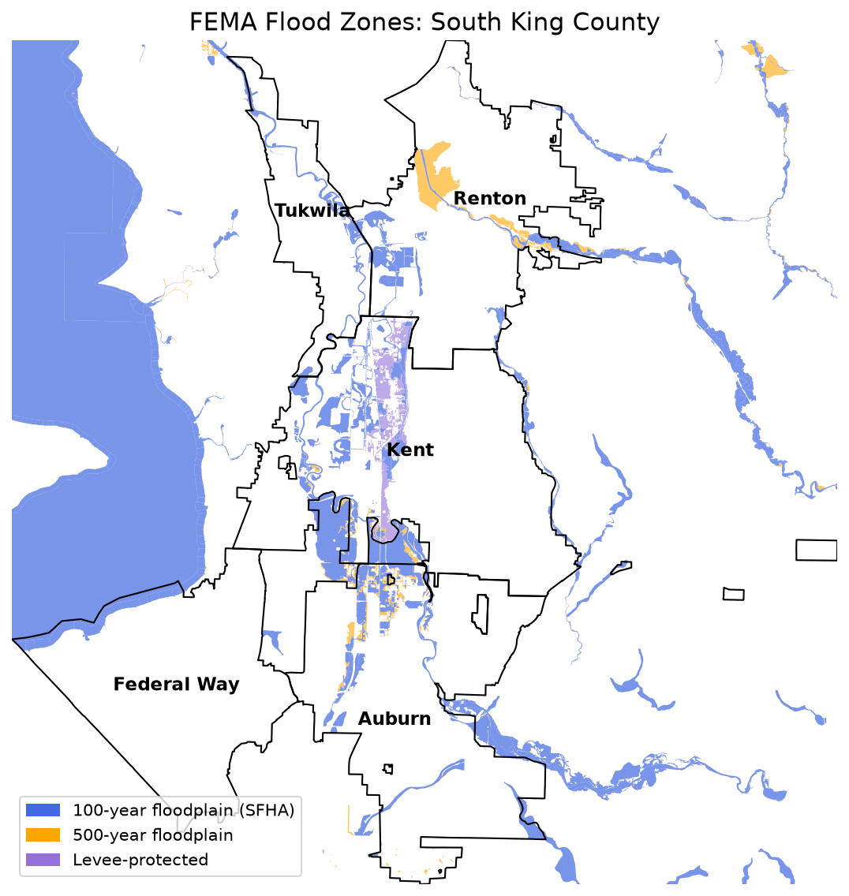
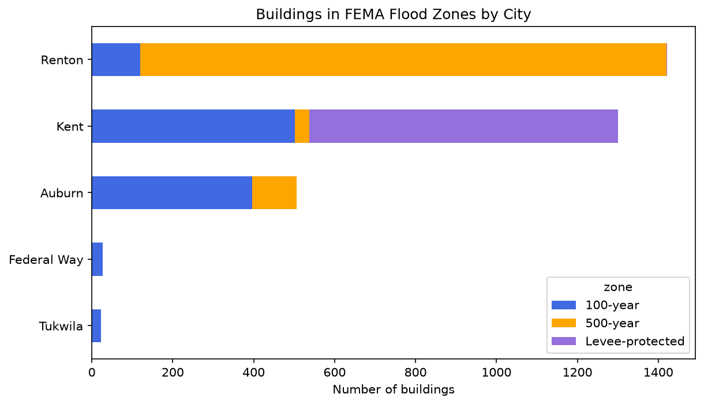
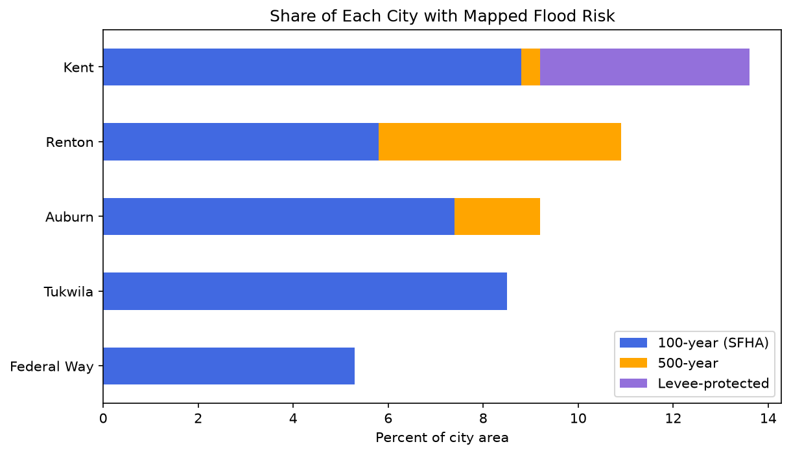

# South King County Flood Risk Analysis



## Overview

How much of South King County lies in FEMA flood zones, and how many buildings are exposed? This project measures the land area and the number of buildings in FEMA's 100-year floodplain, 500-year floodplain and levee-protected areas for five cities (Federal Way, Kent, Auburn, Renton and Tukwila), using Python, FEMA's National Flood Hazard Layer and Microsoft building footprints.

## Key Findings

- **Renton has the most buildings exposed: 1,421**, mostly in the 500-year floodplain along the lower Cedar River.
- **Kent has the most land in flood zones (13.6%)** and the most buildings in the 100-year floodplain (502) and behind levees (762). More than half of Kent's exposed buildings depend on Green River levees.
- **Land area and buildings tell different stories.** 8.5% of Tukwila's land is floodplain, but only 22 buildings sit in it. Renton ranks second by area but first by buildings.
- **Federal Way has the least exposure:** 5.3% of its land and 27 buildings (0.1%), mainly along Puget Sound shoreline, lakes and creeks.
- **Counting only the 100-year floodplain undercounts Kent's risk by about a third** of its flood-zone land. Levee-protected areas are mapped separately by FEMA and are still at risk if a levee is overtopped or fails.

### Buildings in flood zones



| City | 100-year | 500-year | Levee-protected | Total | % of buildings |
|---|---|---|---|---|---|
| Renton | 119 | 1,301 | 1 | **1,421** | 4.9% |
| Kent | 502 | 36 | 762 | **1,300** | 3.9% |
| Auburn | 396 | 110 | 0 | **506** | 2.1% |
| Federal Way | 27 | 0 | 0 | **27** | 0.1% |
| Tukwila | 22 | 0 | 0 | **22** | 0.4% |

### Land area in flood zones



| City | 100-year | 500-year | Levee-protected | Total |
|---|---|---|---|---|
| Kent | 8.8% | 0.4% | 4.4% | **13.6%** |
| Renton | 5.8% | 5.1% | 0.0% | **10.9%** |
| Auburn | 7.4% | 1.8% | 0.0% | **9.2%** |
| Tukwila | 8.5% | 0.0% | 0.0% | **8.5%** |
| Federal Way | 5.3% | 0.0% | 0.0% | **5.3%** |

## Data

- [FEMA National Flood Hazard Layer, King County (53033C), effective September 23, 2026](https://msc.fema.gov/portal/advanceSearch): flood hazard areas (S_FLD_HAZ_AR)
- [Microsoft US Building Footprints, Washington](https://github.com/microsoft/USBuildingFootprints): about 3.1 million building outlines
- [U.S. Census Bureau TIGER/Line 2024 Places](https://www2.census.gov/geo/tiger/TIGER2024/PLACE/): city boundaries

The FEMA and Microsoft data are not included in this repo because of their size. Download them from the links above and unzip them into `data/` (FEMA into `data/53033C_20260923/`, buildings as `data/Washington.geojson`).

## Methods

1. Loaded FEMA flood hazard areas and city boundaries with GeoPandas
2. Reprojected all layers to Washington State Plane South, US feet (EPSG:2927)
3. Classified flood zones:
   - **100-year (SFHA):** zones A, AE, AH, AO and coastal VE
   - **500-year:** zone X, 0.2% annual chance subtype
   - **Levee-protected:** zone X, "Area with Reduced Flood Risk due to Levee" subtype
4. **Land area:** intersected flood zones with city boundaries (overlay) and summed area by city
5. **Buildings:** loaded only buildings inside the study area's bounding box, converted each to a point inside its footprint, then used spatial joins to assign each building a city and a flood zone
6. Counted buildings and calculated percentages by city and zone

## Tools

Python, GeoPandas, pandas, matplotlib, JupyterLab, Git

## Limitations

- City areas come from Census boundaries and may include some water.
- FEMA maps show regulatory flood zones, not every possible flood. Results describe mapped risk only.
- Microsoft building footprints were generated from imagery and released in 2018, so newer buildings may be missing, and footprints do not show building use or value.

## How to run

```
conda create -n gis -c conda-forge python=3.12 geopandas jupyterlab matplotlib
conda activate gis
jupyter lab
```

Download the data (see Data), then open `flood_risk.ipynb` and choose Run → Run All Cells.

## Author

Shae Limtiaco · [GitHub](https://github.com/shaerlimtiaco)